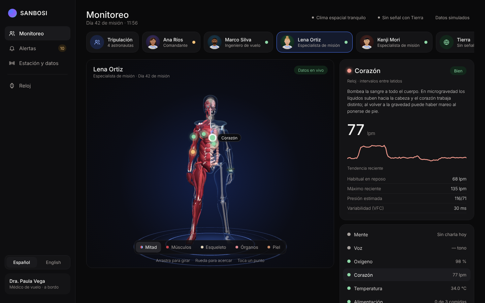

# SANBOSI · Health Monitoring for Astronauts

**NASA Space Apps Challenge 2026** · Challenge *Create Health Monitoring Software for Astronauts on Space Missions*
Team **Sanbosi-FET** · Neiva, Huila, Colombia

SANBOSI is a health monitoring system for space crews. A **smartwatch** on each astronaut's wrist measures vital signs and listens to their voice. An **onboard station** compares that data with each crew member's personal baseline, links it to the health risks catalogued by NASA and answers by voice. **Earth** receives summaries and alerts over a **Delay/Disruption Tolerant Network (DTN)**, even when the signal is lost.

> **Design principle:** SANBOSI **detects variations, it does not diagnose.** It compares each astronaut with themselves, explains what changed and which NASA risk it relates to, and suggests a next step. Medical decisions always belong to the flight surgeon and the mission's validated protocols.

📄 **Project document:** [English (PDF)](SANBOSI-SPACE-HEALTH-English.pdf) · [Español (PDF)](SANBOSI-SPACE-HEALTH-Espanol.pdf)



---

## Contents

1. [Project document](#project-document)
1. [What it does](#what-it-does)
2. [Quick start](#quick-start)
3. [How it works](#how-it-works)
4. [Components](#components)
5. [Data sources](#data-sources)
6. [Voice assistant](#voice-assistant)
7. [NASA risks and rules](#nasa-risks-and-rules)
8. [Demo crew](#demo-crew)
9. [API](#api)
10. [Repository structure](#repository-structure)
11. [Tests](#tests)
12. [Configuration](#configuration)
13. [Proposed hardware](#proposed-hardware)
14. [Limitations](#limitations)
15. [Credits](#credits)

---

## Project document

The full project write-up is in the repository root, in English and Spanish:

| Document | Pages | Contents |
|---|---|---|
| [**SANBOSI-SPACE-HEALTH-English.pdf**](SANBOSI-SPACE-HEALTH-English.pdf) | 35 | English version |
| [**SANBOSI-SPACE-HEALTH-Espanol.pdf**](SANBOSI-SPACE-HEALTH-Espanol.pdf) | 37 | Spanish version |

It covers:

1. **Project identification** – general information, team members and challenge description.
2. **Executive summary** – the project in one minute, objectives, benefits and what makes SANBOSI different.
3. **Health and radiation research** – what to monitor, how radiation is measured, what the detector provides, watch and health sensors, recommended nutrition.
4. **Solution design** – what the application shows, health-area additions, mental health and AI assistant, voice analysis, smart routines and reminders, how everything connects, hackathon demo, use of real NASA data, onboard and Earth communications, change detection and alert states.
5. **Hardware architecture and radiological health protocol for wearable dosimetry** – from prototype to space version, radiation-tolerant solid-state detectors and light shielding, hermetic sealing and passive thermal control, fault-tolerant processing (triple modular redundancy), solid-state batteries and inductive charging, and how the dosimeter works (continuous detection, clinical dose calculation and early warning).
6. **References.**

---

## What it does

| Part | What it does |
|---|---|
| **Astronaut watch** | Measures pulse, blood oxygen (SpO₂), skin temperature, breathing rate, estimated blood pressure, heart rate variability (HRV), irregular rhythm, sleep, hydration and activity. Talks by voice (“Hey/Hi Sanbosi”), logs water and meals, guides breathing, warns about solar storms and calls the doctor. |
| **Onboard station** | Receives data every second, builds each crew member's baseline, detects changes, links them to NASA's **Human System Risk Board (HSRB)** risks, analyzes the voice (energy, tension, fatigue, mood) and answers questions with real data. |
| **Flight surgeon panel** | One single view: crew overview, each astronaut with an **interactive 3D body** (muscles, skeleton, organs and 8 points showing their function and status), charts, alerts, voice, diary and chat. **Spanish / English** switch. |
| **Earth (DTN)** | Receives encrypted and signed (BPSec) summaries and alerts over DTN. Without contact, data stays in custody on board and is delivered when the signal returns. Earth can send messages that reach the watch. |

| | |
|---|---|
|  |  |
| Crew: radiation, alerts, Earth link and status of each astronaut | Interactive watch with voice assistant |
|  |  |
| **Blood** point with real Inspiration4 lab tests (NASA OSDR) | Earth view: what arrives over DTN |

> Screenshots show the interface in Spanish; switch to English with the language selector (bottom left of the panel, top right of the watch).

---

## Quick start

**Requirements:** Python 3.10–3.13 and internet the first time (dependencies and live NASA data). For voice, **Chrome or Edge**.

| System | How to open it |
|---|---|
| **macOS** | Double-click `Abrir SANBOSI.command` (if macOS blocks it: right-click → Open) |
| **Windows** | Double-click `Abrir SANBOSI (Windows).bat` (when installing Python, check *Add python.exe to PATH*) |
| **Linux / terminal** | `./start.sh` |

```bash
git clone https://github.com/MiguelDev21/SANBOSI-SPACE-HEALTH.git
cd SANBOSI-SPACE-HEALTH
./start.sh              # creates .venv, installs dependencies, starts the station and 4 simulated watches
```

It opens in the browser:

| URL | What it is |
|---|---|
| http://localhost:8700 | Station panel (flight surgeon) |
| http://localhost:8700/watch | Astronaut watch |
| http://localhost:8700/?ver=earth | Earth view |

Options: `./start.sh --offline` (no internet, simulated data) · `./start.sh --full` (also starts the full DTN framework with real SGP4 orbit on :8000 and its 3D globe on :8080; requires Node/npm).

**Local generative AI (optional):** no internet or cloud needed, with [Ollama](https://ollama.com):
```bash
ollama pull llama3.2:3b     # or qwen2.5:7b with 16 GB of RAM
```
Without Ollama the assistant answers with its rules engine + NASA knowledge base, which works the same for the demo.

---

## How it works

```
 WATCH (wrist)                   STATION (on board)                                EARTH
 ─────────────                   ──────────────────                                ─────
 vitals every 1 s ─► /api/ingest ─► personal baseline ─► HSRB risk engine ────────┐
 voice (WAV 16 kHz) ► /api/voice ─► voice biomarkers ─► mood indices              ├─► alerts ──► panel (SSE)
 dictation/question ► /api/chat  ─► assistant (rules+RAG / Ollama)                 │
 actions (water,                  ISS environment (CO₂, O₂, pressure)              └─► DTN bundles ──► Houston
 meals, shelter) ──► /api/watch   radiation (RadLab + GOES)                             (BPSec, custody,
                                                                                        contact windows)
 ◄──────────── spoken answer, alerts, messages from Houston ◄─────────────────────────────────────────────
```

1. **Capture.** The watch sends batches with pulse, beat-to-beat intervals (RR), SpO₂, skin temperature, breathing rate, estimated blood pressure, accelerometer, battery, hydration and sleep. It stores data if the link drops (*store-and-forward*).
2. **Personal baseline.** Each crew member has their own usual range; it only updates when there are no active alerts, so it never “learns” abnormal values.
3. **Voice.** Pitch (F0), intensity, pauses, speech rate, jitter and HNR are measured and compared with the person's usual voice to compute **energy, tension, fatigue and mood**.
4. **Risk engine.** Explainable rules (with numeric evidence) cross vital signs, voice, reported symptoms (“I have a headache”), environment and radiation with **31 HSRB risks**.
5. **Status levels:** *Normal · Watch · Attention · Critical · Check sensor* (when the data looks like a sensor fault rather than the body).
6. **Response.** The watch speaks and suggests concrete steps; the panel updates live (Server-Sent Events).
7. **DTN to Earth.** Summaries and alerts travel as prioritized *bundles* (alerts = EXPEDITED), with custody on board and latency depending on the destination (ISS, Moon 1.3 s, Mars 10 min).

---

## Components

### Watch (`web/watch.html`, `web/watch.js`, `watch/`)
- Working replica of the team's design: 6 swipeable pages (agenda, watch face, your day, radiation, heart, energy), quick settings (↓), alerts (↑), crown (home/apps), side button (talk) and 25 views with live data.
- **Wake word** “Hey/Hi/Hola Sanbosi”, tolerant to pronunciation variants (sambosi, zan bosi, mambosi, *somebody*, *sam bossy*…), with continuous listening that restarts on its own.
- Answers as soon as you stop talking, and the English voice uses the most natural voice available in the browser.
- `watch/simulator.py` simulates 4 watches (“firmware”: batches, retries, commands) and `watch/physiology.py` simulates the body with **15 scenarios**:
  `nominal, eva, eva_co2, dcs, cabin_co2, hypoxia, arrhythmia, fever, fatigue, orthostatic, dehydration, solar_storm, stress, unresponsive, sensor_loose`.

### Station (`station/`)
| File | Purpose |
|---|---|
| `app.py` | Web server and API (Starlette + Uvicorn), Spanish/English translation of responses |
| `core.py` | Orchestrates ingest → baseline → risks → alerts → AI → DTN |
| `features.py` | HRV (RMSSD), rhythm irregularity, personal baseline |
| `risk_engine.py` | Clinical rules mapped to HSRB risks, symptom detection in what the astronaut says |
| `voice.py` | Voice biomarkers (NumPy/SciPy) |
| `ai.py` | Assistant: question intent + measured data + NASA knowledge base (RAG); optional Ollama |
| `dtn_link.py` | Embedded or external DTN link (framework arXiv:2605.21624) |
| `i18n.py` | Translation of findings, risks and answers into English |
| `store.py` | SQLite (series, voice, chat, alerts, events) |
| `nasa/` | Connectors: `iss_live.py`, `radiation.py` (RadLab + GOES), `osdr.py` |
| `knowledge/hsrb_risks.json` | 31 HSRB risks with description (ES/EN), keywords and countermeasures |
| `knowledge/inspiration4_labs.json` | Real Inspiration4 blood tests (OSD-569/575) |

### Panel (`web/index.html`, `web/app.js`)
- **Monitoring** with a top selector: *Crew*, each astronaut (avatar and status) and *Earth*.
- **3D astronaut** (Three.js, team model): rotates, half muscles / half skeleton, organ and skin layers, and 8 points: mind, voice, oxygen, heart, temperature, nutrition, radiation and **blood**. Each point shows **its function in the body**, its status and live data.
- Vital sign cards, trends with the usual range, detected changes, voice analysis, diary/self-report and chat with the assistant.
- **Alerts** (review and mark as resolved) and **Station & data** (sources, test scenarios, signal loss, mission profile, CSV export).
- Everything in **Spanish / English**.

### DTN (`dtn-framework/`)
Framework by K. Grover and M. Ponce (*arXiv:2605.21624*, repository `kritgrover/iss-simulator`, commit in `dtn-framework/UPSTREAM_COMMIT.txt`): bundles, store-and-forward, custody transfer, contact windows with ground stations and BPSec security (HMAC-SHA256 + AES-256-CBC).

---

## Data sources

| Source | What it provides | Access |
|---|---|---|
| **ISS Live! (NASA JSC, Lightstreamer)** | Real ISS environment: ppCO₂, ppO₂, ppN₂, cabin pressure and temperature, airlock | `push.lightstreamer.com`, adapter `ISSLIVE` |
| **NASA OSDR – RadLab** | Dose rate from ISS dosimeters (DosTel) | `visualization.osdr.nasa.gov/radlab/api` |
| **NOAA SWPC – GOES** | Protons ≥10 MeV and S-scale of solar radiation storms | `services.swpc.noaa.gov/json/goes/primary/integral-protons-1-day.json` |
| **NASA OSDR – Inspiration4** | Real blood tests (complete blood count OSD-569, metabolic panel OSD-575) from the 4 civilian crew members | [OSD-569](https://osdr.nasa.gov/bio/repo/data/studies/OSD-569) · [OSD-575](https://osdr.nasa.gov/bio/repo/data/studies/OSD-575) |
| **NASA HSRB / OCHMO** | Catalog of human health risks and countermeasures | nasa.gov/hhp/human-system-risks |

Each connector tries live data, caches it in `station/data/cache/` and, without network, uses a simulated model. The panel always shows the origin: **LIVE**, **CACHE**, **SIM** or **+INJECTION** (test scenario).

**Inspiration4 lab tests.** The crew members are de-identified (C001–C004) and paired with the demo's fictional crew (CM-01↔C001 … CM-04↔C004). Dates: L-92, L-44, L-3 (before launch) and R+1, R+45, R+82, R+194 (after return). Baseline = pre-flight average; change = R+1 vs. baseline. There were no clinical tests in orbit. Example: C003 (Lena) returned with glucose 103 mg/dL (+44%) and potassium 3.0 mmol/L (−14%), both out of range → *Attention* status.

**Radiation.** Estimated mission dose = days × 0.35 mSv/day (midpoint of NASA's ISS range, 0.2–0.5) + the dose measured by the dosimeter, compared with NASA's 600 mSv career limit.

---

## Voice assistant

Say **“Hey Sanbosi”** (or “Hola Sanbosi” in Spanish) and wait for the question, or say it all at once. It works in English and Spanish.

| Purpose | English | Spanish |
|---|---|---|
| Summary | “How am I doing?” | “¿Cómo estoy?” |
| Vitals | “What's my heart rate?”, “What's my oxygen?”, “Do I have a fever?”, “What's my blood pressure?” | “¿Cómo está mi corazón?”, “¿Cuánto oxígeno tengo?” |
| Sleep | “How did I sleep?” | “¿Cuánto dormí?” |
| Water / food | “I drank a glass of water”, “I had lunch” | “Tomé un vaso de agua”, “Ya almorcé” |
| Radiation | “How's the radiation?”, “I'm in the shelter” | “¿Cómo está la radiación?”, “Estoy en el refugio” |
| Mind | “How do I sound?”, “I feel stressed”, “Breathe with me” | “¿Cómo sueno?”, “Respira conmigo” |
| Blood | “How are my blood tests?”, “How is my glucose?” | “¿Cómo están mis exámenes de sangre?” |
| Explain | “What is bone loss?”, “Why is radiation dangerous?” | “¿Qué es la pérdida ósea?” |
| Symptoms | “I have a headache”, “I feel dizzy” | “Me duele la cabeza” |
| Routine / alerts | “What's next?”, “Show my alerts” | “¿Qué sigue?”, “Muéstrame mis avisos” |
| Doctor / Earth | “Call the doctor”, “Are we in contact with Earth?” | “Avisa al médico” |
| Medical check | “My blood pressure is 118 over 76” | “Mi presión es 118 sobre 76”, “Glucosa 96” |

A **question** (“do I have a fever?”) looks up data; a **statement** (“I have a fever”) is logged as a symptom and shown to the flight surgeon. If there is a critical change, the assistant says it first.

---

## NASA risks and rules

The engine uses 31 HSRB risks, including: cardiovascular, orthostatic intolerance, venous thromboembolism, hypoxia, CO₂ exposure, radiation, sleep and fatigue, behavioral health, team performance, EVA, decompression sickness, immune, sensorimotor, SANS, kidney stones, muscle, bone, nutrition, medications, hearing and Earth-independent operations.

Main thresholds (`station/config.py`, centralized so they can be validated against NASA-STD-3001):

| Variable | Threshold |
|---|---|
| Resting pulse high / low | > 100 / < 45 bpm (EVA > 160) |
| SpO₂ | warning < 94%, critical < 90% |
| Fever (skin) | > 36.9 °C or +1.2 °C above baseline |
| Systolic pressure | > 140 or < 90 mmHg |
| Breathing rate | > 22 breaths/min |
| HRV (RMSSD) | < 60% of personal baseline |
| Cabin CO₂ | warning 3 mmHg, critical 5 mmHg (suit 8 mmHg) |
| EVA metabolic rate | > 580 W |
| GOES protons ≥10 MeV | ≥ 10 pfu (S1 storm) |
| Short sleep | < 6 h |

---

## Demo crew

| ID | Name (fictional) | Role | Real lab tests |
|---|---|---|---|
| CM-01 | Ana Ríos | Commander | Inspiration4 C001 |
| CM-02 | Marco Silva | Flight engineer | Inspiration4 C002 |
| CM-03 | Lena Ortiz | Mission specialist | Inspiration4 C003 |
| CM-04 | Kenji Mori | Mission specialist | Inspiration4 C004 |

Flight surgeon: Dr. Paula Vega. Mission day: 42.

---

## API

| Method | Route | Description |
|---|---|---|
| POST | `/api/ingest` | The watch sends `{"device_id","crew_id","packets":[{ts,hr,rr_ms[],spo2,skin_temp,resp_rate,sbp,dbp,accel_g,…}]}` |
| GET | `/api/state` · `/api/stream` (SSE) | Crew status, environment, radiation, DTN and alerts |
| GET | `/api/crew` · `/api/crew/{id}` | Crew · detail (series, findings, voice, chat) |
| POST | `/api/voice/{id}?transcript=&calibrate=&ask=&log=` | WAV audio → biomarkers, indices and answer |
| POST | `/api/chat/{id}` | `{"text": "...", "source": "texto"|"voz"}` → assistant |
| GET | `/api/labs/{id}` | Real Inspiration4 blood tests for the crew member |
| POST | `/api/scenario` | `{"crew_id": "CM-01"|"ALL", "scenario": "eva_co2"}` |
| POST | `/api/dtn` | `{"blackout": true}` or `{"destination": "MARTE"}` |
| GET/POST | `/api/earth/inbox` · `/api/earth/send` | Earth view |
| GET/POST | `/api/watch/{id}/view` · `/api/watch/{id}/action` · `/api/watch/{id}/feed` | What the watch shows and its actions (`water`, `meal`, `shelter`, `doctor`, `breathe`, `sync`…) |
| GET | `/api/sources` · `/api/knowledge` · `/api/export/{id}.csv` · `/api/version` | Sources, HSRB knowledge base, export, version |
| — | `/tripulantes`, `/tripulantes/{id}/resumen`, `/tripulantes/{id}/metricas/{codigo}`, `/tripulantes/{id}/linea-base`, `/alertas` (GET/PATCH), `/autorreportes`, `/ingesta/lote` | Team integration contract |

Add `?lang=en` to any route to receive texts in English.

---

## Repository structure

```
SANBOSI-SPACE-HEALTH/
├── Abrir SANBOSI.command          double-click launcher (macOS)
├── Abrir SANBOSI (Windows).bat    double-click launcher (Windows)
├── start.sh                       terminal launcher (macOS/Linux)
├── SANBOSI-SPACE-HEALTH-English.pdf   project document (English)
├── SANBOSI-SPACE-HEALTH-Espanol.pdf   project document (Spanish)
├── requirements.txt
├── PLAN.md                        plan, architecture and demo script (Spanish)
├── LEEME-PRIMERO.txt              short instructions for whoever receives the project (Spanish)
├── station/                       onboard station (server, AI, risks, voice, DTN, NASA connectors)
├── watch/                         watch simulator and physiological model
├── web/                           panel, watch, translations and 3D model (web/vendor)
├── dtn-framework/                 DTN framework (arXiv:2605.21624)
├── tests/                         end-to-end and contract tests
└── docs/                          screenshots
```

---

## Tests

```bash
source .venv/bin/activate
python tests/test_e2e.py         # full flow: watch → station → alerts → voice → DTN → Earth → CSV
python tests/test_contrato.py    # team contract (with the station running)
```

---

## Configuration

Environment variables (see `station/config.py`):

| Variable | Default | Purpose |
|---|---|---|
| `SANBOSI_PORT` | 8700 | Server port |
| `NASA_MODE` | auto | `auto` / `live` / `sim` |
| `DTN_MODE` | embedded | `embedded` / `external` |
| `DTN_TIME_SCALE` | 20 | Speeds up the orbit (92 min ≈ 4.6 min) |
| `MCC_STATION` | washington | Mission control ground station |
| `OLLAMA_MODEL` | llama3.2:3b | Optional local model |
| `MISSION_DAY` | 42 | Mission day shown |

---

## Proposed hardware

The prototype simulates the watch, but it is designed for a **commercial smartwatch**: optical PPG sensor (pulse, SpO₂, HRV), skin temperature, accelerometer and microphone, connected to the station over the spacecraft's local network. The “firmware” in `watch/simulator.py` already implements the batching, retries and offline storage a real device would have.

---

## Limitations

- Voice indices and thresholds are **supporting indicators** for the demo; this is not a medical device.
- Blood pressure from the watch is **estimated** (cuffless), as it would be on a real wearable.
- Watch physiology is **simulated**; ISS environment, radiation and Inspiration4 lab tests are **real data** when there is a connection.
- Speech recognition uses the browser's dictation (Chrome/Edge, requires internet). For offline transcription: `pip install faster-whisper`.
- The microphone works on `localhost`; from another device on the network HTTPS is required.

---

## Credits

- **Team Sanbosi-FET** (Neiva, Huila, Colombia): Victor Andres Castro Ospina, Miguel Antonio Urbano Silva, Santiago González Becerra, Nicolas Guillermo Peña, Duván Daniel Lozano Ramírez and Miguel Ángel Bahamón — idea, research, watch design, 3D body model, hardware proposal and software.
- **DTN framework:** K. Grover and M. Ponce, *An Open-Source Framework to Emulate Delay and Disruption Tolerant Networks for International Space Station Communication*, ISORC 2026, [arXiv:2605.21624](https://arxiv.org/abs/2605.21624) (`kritgrover/iss-simulator`).
- **Data:** NASA ISS Live!, NASA OSDR (RadLab, Inspiration4 OSD-569/575), NOAA SWPC GOES, NASA Human System Risk Board.
- **Libraries:** Starlette, Uvicorn, NumPy, SciPy, cryptography, Three.js.
