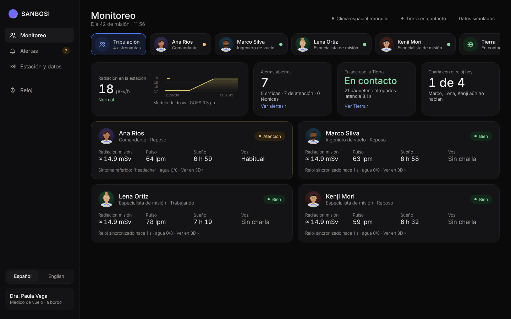
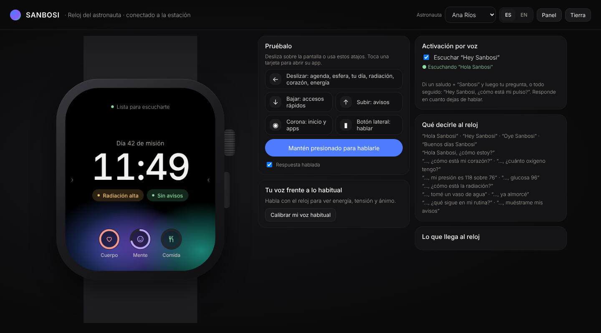
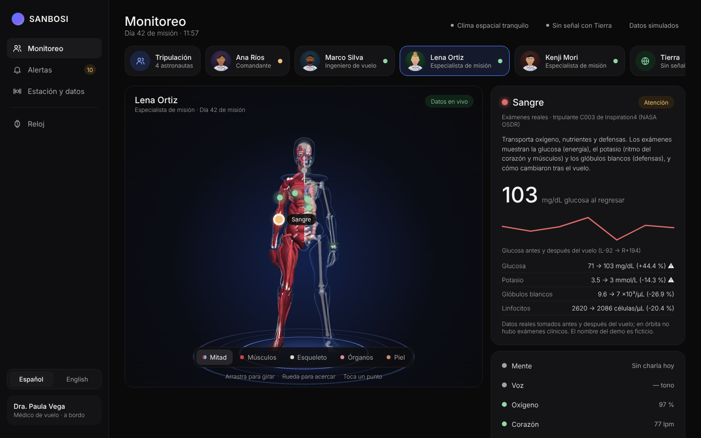
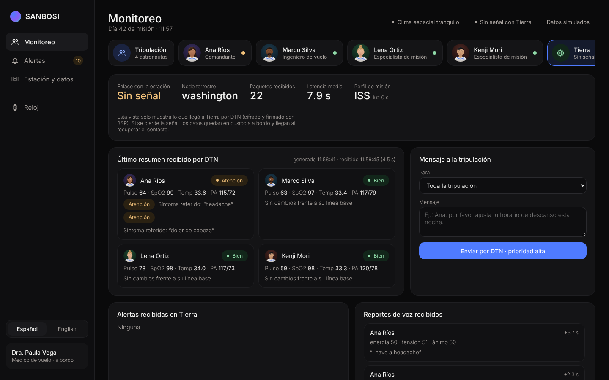

# SANBOSI · Monitoreo de salud para astronautas

**NASA Space Apps Challenge 2026** · Reto *Create Health Monitoring Software for Astronauts on Space Missions*
Equipo **Sanbosi-FET** · Neiva, Huila, Colombia

SANBOSI es un sistema de monitoreo de salud para tripulaciones espaciales. Un **reloj inteligente** en la muñeca de cada astronauta mide signos vitales y escucha su voz. Una **estación a bordo** compara esos datos con la línea base personal de cada tripulante, los relaciona con los riesgos de salud catalogados por la NASA y responde por voz. La **Tierra** recibe resúmenes y alertas mediante una red tolerante a retrasos (**DTN**), aunque se pierda la señal.

> **Principio de diseño:** SANBOSI **detecta variaciones, no diagnostica.** Compara a cada astronauta consigo mismo, explica qué cambió y con qué riesgo NASA se relaciona, y sugiere un siguiente paso. La decisión médica es siempre del médico de vuelo y de los protocolos validados de la misión.


---

## Contenido

1. [Qué hace](#qué-hace)
2. [Arranque rápido](#arranque-rápido)
3. [Cómo funciona](#cómo-funciona)
4. [Componentes](#componentes)
5. [Fuentes de datos](#fuentes-de-datos)
6. [Asistente por voz](#asistente-por-voz)
7. [Riesgos NASA y reglas](#riesgos-nasa-y-reglas)
8. [Tripulación de la demo](#tripulación-de-la-demo)
9. [API](#api)
10. [Estructura del repositorio](#estructura-del-repositorio)
11. [Pruebas](#pruebas)
12. [Configuración](#configuración)
13. [Hardware propuesto](#hardware-propuesto)
14. [Limitaciones](#limitaciones)
15. [Créditos](#créditos)

---

## Qué hace

| Parte | Qué hace |
|---|---|
| **Reloj del astronauta** | Mide pulso, oxígeno en sangre (SpO₂), temperatura de piel, respiración, presión estimada, variabilidad cardíaca (VFC/HRV), ritmo irregular, sueño, hidratación y actividad. Conversa por voz (“Hola/Hey Sanbosi”), registra agua y comidas, guía respiraciones, avisa tormentas solares y llama al médico. |
| **Estación a bordo** | Recibe los datos cada segundo, calcula la línea base de cada tripulante, detecta cambios, los relaciona con los riesgos del **Human System Risk Board (HSRB)** de la NASA, analiza la voz (energía, tensión, fatiga, ánimo) y responde preguntas con datos reales. |
| **Panel del médico de vuelo** | Una sola vista: tripulación, cada astronauta con su **cuerpo 3D interactivo** (músculos, esqueleto, órganos y 8 puntos con su función y estado), gráficas, alertas, voz, diario y chat. Selector **Español / English**. |
| **Tierra (DTN)** | Recibe resúmenes y alertas cifrados y firmados (BPSec) por DTN. Si no hay contacto, los datos quedan en custodia a bordo y llegan al recuperar la señal. Desde la Tierra se envían mensajes que llegan al reloj. |

| | |
|---|---|
|  |  |
| Tripulación: radiación, alertas, enlace a Tierra y estado de cada astronauta | Reloj interactivo con asistente por voz |
|  |  |
| Punto **Sangre** con exámenes reales de Inspiration4 (NASA OSDR) | Vista Tierra: lo que llega por DTN |

---

## Arranque rápido

**Requisitos:** Python 3.10–3.13 e internet la primera vez (dependencias y datos NASA en vivo). Para la voz, **Chrome o Edge**.

| Sistema | Cómo abrirlo |
|---|---|
| **macOS** | Doble clic en `Abrir SANBOSI.command` (si macOS lo bloquea: clic derecho → Abrir) |
| **Windows** | Doble clic en `Abrir SANBOSI (Windows).bat` (al instalar Python marca *Add python.exe to PATH*) |
| **Linux / terminal** | `./start.sh` |

```bash
git clone https://github.com/MiguelDev21/SANBOSI-SPACE-HEALTH.git
cd SANBOSI-SPACE-HEALTH
./start.sh              # crea .venv, instala dependencias, levanta la estación y 4 relojes simulados
```

Se abre en el navegador:

| URL | Qué es |
|---|---|
| http://localhost:8700 | Panel de la estación (médico de vuelo) |
| http://localhost:8700/watch | Reloj del astronauta |
| http://localhost:8700/?ver=earth | Vista Tierra |

Opciones: `./start.sh --offline` (sin internet, datos simulados) · `./start.sh --full` (levanta además el framework DTN completo con órbita SGP4 real en :8000 y su globo 3D en :8080; requiere Node/npm).

**IA generativa local (opcional):** sin internet ni nube, con [Ollama](https://ollama.com):
```bash
ollama pull llama3.2:3b     # o qwen2.5:7b con 16 GB de RAM
```
Sin Ollama el asistente responde con su motor de reglas + base de conocimiento NASA, que funciona igual para la demo.

---

## Cómo funciona

```
 RELOJ (muñeca)                  ESTACIÓN (a bordo)                                TIERRA
 ─────────────                   ──────────────────                                ──────
 signos cada 1 s ──► /api/ingest ─► línea base personal ─► motor de riesgos HSRB ─┐
 voz (WAV 16 kHz) ─► /api/voice  ─► biomarcadores de voz ─► índices de ánimo      ├─► alertas ──► panel (SSE)
 dictado/pregunta ─► /api/chat   ─► asistente (reglas+RAG / Ollama)                │
 acciones (agua,                  ambiente ISS (CO₂, O₂, presión)                  └─► bundles DTN ──► Houston
 comida, refugio) ─► /api/watch   radiación (RadLab + GOES)                             (BPSec, custodia,
                                                                                        ventanas de contacto)
 ◄──────────── respuesta por voz, avisos, mensajes de Houston ◄───────────────────────────────────────────
```

1. **Captura.** El reloj envía lotes con pulso, intervalos entre latidos (RR), SpO₂, temperatura de piel, respiración, presión estimada, acelerómetro, batería, hidratación y sueño. Guarda los datos si pierde el enlace (*store-and-forward*).
2. **Línea base personal.** Cada tripulante tiene su rango habitual; se actualiza solo cuando no hay alertas activas, para no “aprender” lo anormal.
3. **Voz.** Se miden tono (F0), intensidad, pausas, velocidad del habla, jitter y HNR, y se comparan con la voz habitual de la persona para calcular **energía, tensión, fatiga y ánimo**.
4. **Motor de riesgos.** Reglas explicables (con evidencia numérica) cruzan signos, voz, síntomas referidos (“me duele la cabeza”), ambiente y radiación con **31 riesgos HSRB**.
5. **Estados:** *Normal · Observación · Atención · Crítica · Revisar sensor* (cuando el dato parece un fallo del sensor y no del cuerpo).
6. **Respuesta.** El reloj habla y propone pasos concretos; el panel se actualiza en vivo (Server-Sent Events).
7. **DTN a Tierra.** Resúmenes y alertas viajan como *bundles* con prioridad (alertas = EXPEDITED), custodia a bordo y latencia según el destino (ISS, Luna 1,3 s, Marte 10 min).

---

## Componentes

### Reloj (`web/watch.html`, `web/watch.js`, `watch/`)
- Réplica funcional del diseño del equipo: 6 páginas deslizables (agenda, esfera, tu día, radiación, corazón, energía), accesos rápidos (↓), avisos (↑), corona (inicio/apps), botón lateral (hablar) y 25 vistas con datos en vivo.
- **Palabra de activación** “Hola/Hey/Hi Sanbosi” tolerante a pronunciaciones (sambosi, zan bosi, mambosi, *somebody*, *sam bossy*…), con escucha continua que se reactiva sola.
- Responde en cuanto dejas de hablar (sin esperar varios segundos) y la voz en inglés usa la voz más natural disponible del navegador.
- `watch/simulator.py` simula 4 relojes (“firmware”: lotes, reintentos, comandos) y `watch/physiology.py` el cuerpo con **15 escenarios**:
  `nominal, eva, eva_co2, dcs, cabin_co2, hypoxia, arrhythmia, fever, fatigue, orthostatic, dehydration, solar_storm, stress, unresponsive, sensor_loose`.

### Estación (`station/`)
| Archivo | Función |
|---|---|
| `app.py` | Servidor web y API (Starlette + Uvicorn), traducción ES/EN de las respuestas |
| `core.py` | Orquesta ingesta → línea base → riesgos → alertas → IA → DTN |
| `features.py` | VFC (RMSSD), irregularidad del ritmo, línea base personal |
| `risk_engine.py` | Reglas clínicas mapeadas a riesgos HSRB, detección de síntomas en lo que dice el astronauta |
| `voice.py` | Biomarcadores de voz (NumPy/SciPy) |
| `ai.py` | Asistente: intención de la pregunta + datos medidos + base NASA (RAG); Ollama opcional |
| `dtn_link.py` | Enlace DTN embebido o externo (framework arXiv:2605.21624) |
| `i18n.py` | Traducción de hallazgos, riesgos y respuestas al inglés |
| `store.py` | SQLite (series, voz, chat, alertas, eventos) |
| `nasa/` | Conectores: `iss_live.py`, `radiation.py` (RadLab + GOES), `osdr.py` |
| `knowledge/hsrb_risks.json` | 31 riesgos HSRB con descripción (ES/EN), palabras clave y contramedidas |
| `knowledge/inspiration4_labs.json` | Exámenes de sangre reales de Inspiration4 (OSD-569/575) |

### Panel (`web/index.html`, `web/app.js`)
- **Monitoreo** con selector superior: *Tripulación*, cada astronauta (avatar y estado) y *Tierra*.
- **Astronauta en 3D** (Three.js, modelo del equipo): gira, mitad músculos / mitad esqueleto, capas de órganos y piel, y 8 puntos: mente, voz, oxígeno, corazón, temperatura, alimentación, radiación y **sangre**. Cada punto muestra **su función en el cuerpo**, su estado y sus datos en vivo.
- Tarjetas de signos, tendencias con el rango habitual, cambios detectados, análisis de voz, diario/autorreporte y chat con el asistente.
- **Alertas** (revisar y marcar resueltas) y **Estación y datos** (fuentes, escenarios de prueba, pérdida de señal, perfil de misión, exportación CSV).
- Todo en **Español / English**.

### DTN (`dtn-framework/`)
Framework de K. Grover y M. Ponce (*arXiv:2605.21624*, repositorio `kritgrover/iss-simulator`, commit en `dtn-framework/UPSTREAM_COMMIT.txt`): *bundles*, almacenamiento y reenvío, custodia, ventanas de contacto con estaciones terrenas y seguridad BPSec (HMAC-SHA256 + AES-256-CBC).

---

## Fuentes de datos

| Fuente | Qué aporta | Acceso |
|---|---|---|
| **ISS Live! (NASA JSC, Lightstreamer)** | Ambiente real de la ISS: ppCO₂, ppO₂, ppN₂, presión y temperatura de cabina, esclusa | `push.lightstreamer.com`, adapter `ISSLIVE` |
| **NASA OSDR – RadLab** | Tasa de dosis de los dosímetros de la ISS (DosTel) | `visualization.osdr.nasa.gov/radlab/api` |
| **NOAA SWPC – GOES** | Protones ≥10 MeV y escala S de tormentas solares | `services.swpc.noaa.gov/json/goes/primary/integral-protons-1-day.json` |
| **NASA OSDR – Inspiration4** | Exámenes de sangre reales (hemograma OSD-569, panel metabólico OSD-575) de los 4 tripulantes civiles | [OSD-569](https://osdr.nasa.gov/bio/repo/data/studies/OSD-569) · [OSD-575](https://osdr.nasa.gov/bio/repo/data/studies/OSD-575) |
| **NASA HSRB / OCHMO** | Catálogo de riesgos para la salud humana y contramedidas | nasa.gov/hhp/human-system-risks |

Cada conector intenta en vivo, guarda caché en `station/data/cache/` y, sin red, usa un modelo simulado. El panel muestra siempre el origen: **LIVE**, **CACHE**, **SIM** o **+INYECCIÓN** (escenario de prueba).

**Exámenes Inspiration4.** Los tripulantes están desidentificados (C001–C004) y se parean con la tripulación ficticia de la demo (CM-01↔C001 … CM-04↔C004). Fechas: L-92, L-44, L-3 (antes del lanzamiento) y R+1, R+45, R+82, R+194 (después del regreso). Base = promedio previo al vuelo; cambio = R+1 frente a la base. En órbita no hubo exámenes clínicos. Ejemplo: C003 (Lena) volvió con glucosa 103 mg/dL (+44 %) y potasio 3,0 mmol/L (−14 %), ambos fuera de rango → estado *Atención*.

**Radiación.** Dosis estimada de la misión = días × 0,35 mSv/día (punto medio del rango NASA en la ISS, 0,2–0,5) + la dosis medida por el dosímetro, comparada con el límite de carrera NASA de 600 mSv.

---

## Asistente por voz

Di **“Hola Sanbosi”** o **“Hey Sanbosi”** y espera la pregunta, o dilo todo seguido. Funciona en español e inglés.

| Para | Español | English |
|---|---|---|
| Resumen | “¿Cómo estoy?” | “How am I doing?” |
| Signos | “¿Cómo está mi corazón?”, “¿cuánto oxígeno tengo?”, “¿tengo fiebre?”, “¿cómo está mi presión?” | “What's my heart rate?”, “What's my oxygen?”, “Do I have a fever?” |
| Sueño | “¿Cuánto dormí?” | “How did I sleep?” |
| Agua / comida | “Tomé un vaso de agua”, “Ya almorcé” | “I drank a glass of water”, “I had lunch” |
| Radiación | “¿Cómo está la radiación?”, “Estoy en el refugio” | “How's the radiation?”, “I'm in the shelter” |
| Mente | “¿Cómo sueno?”, “Estoy estresado”, “Respira conmigo” | “How do I sound?”, “Breathe with me” |
| Sangre | “¿Cómo están mis exámenes de sangre?”, “¿cómo está mi glucosa?” | “How are my blood tests?” |
| Explicar | “¿Qué es la pérdida ósea?”, “¿por qué es peligrosa la radiación?” | “What is bone loss?”, “Why is radiation dangerous?” |
| Síntomas | “Me duele la cabeza”, “Me siento mareado” | “I have a headache”, “I feel dizzy” |
| Rutina / avisos | “¿Qué sigue?”, “Muéstrame mis avisos” | “What's next?”, “Show my alerts” |
| Médico / Tierra | “Avisa al médico”, “¿Hay contacto con la Tierra?” | “Call the doctor”, “Are we in contact with Earth?” |
| Control médico | “Mi presión es 118 sobre 76”, “Glucosa 96” | “My blood pressure is 118 over 76” |

Una **pregunta** (“¿tengo fiebre?”) consulta datos; una **afirmación** (“tengo fiebre”) se registra como síntoma y la ve el médico de vuelo. Si hay un cambio crítico, el asistente lo dice primero.

---

## Riesgos NASA y reglas

El motor usa 31 riesgos del HSRB, entre ellos: cardiovascular, intolerancia ortostática, tromboembolismo venoso, hipoxia, exposición a CO₂, radiación, sueño y fatiga, salud conductual, equipo, EVA, descompresión, inmunológico, sensoriomotor, SANS, cálculos renales, músculo, hueso, nutrición, medicamentos, audición y operaciones independientes de la Tierra.

Umbrales principales (`station/config.py`, centralizados para validarlos contra NASA-STD-3001):

| Variable | Umbral |
|---|---|
| Pulso en reposo alto / bajo | > 100 / < 45 lpm (EVA > 160) |
| SpO₂ | aviso < 94 %, crítico < 90 % |
| Fiebre (piel) | > 36,9 °C o +1,2 °C sobre la base |
| Presión sistólica | > 140 o < 90 mmHg |
| Respiración | > 22 rpm |
| VFC (RMSSD) | < 60 % de la base personal |
| CO₂ de cabina | aviso 3 mmHg, crítico 5 mmHg (traje 8 mmHg) |
| Gasto metabólico EVA | > 580 W |
| Protones GOES ≥10 MeV | ≥ 10 pfu (tormenta S1) |
| Sueño corto | < 6 h |

---

## Tripulación de la demo

| ID | Nombre (ficticio) | Rol | Exámenes reales |
|---|---|---|---|
| CM-01 | Ana Ríos | Comandante | Inspiration4 C001 |
| CM-02 | Marco Silva | Ingeniero de vuelo | Inspiration4 C002 |
| CM-03 | Lena Ortiz | Especialista de misión | Inspiration4 C003 |
| CM-04 | Kenji Mori | Especialista de misión | Inspiration4 C004 |

Médico de vuelo: Dra. Paula Vega. Día de misión: 42.

---

## API

| Método | Ruta | Descripción |
|---|---|---|
| POST | `/api/ingest` | El reloj envía `{"device_id","crew_id","packets":[{ts,hr,rr_ms[],spo2,skin_temp,resp_rate,sbp,dbp,accel_g,…}]}` |
| GET | `/api/state` · `/api/stream` (SSE) | Estado de la tripulación, ambiente, radiación, DTN y alertas |
| GET | `/api/crew` · `/api/crew/{id}` | Tripulación · detalle (series, hallazgos, voz, chat) |
| POST | `/api/voice/{id}?transcript=&calibrate=&ask=&log=` | Audio WAV → biomarcadores, índices y respuesta |
| POST | `/api/chat/{id}` | `{"text": "...", "source": "texto"|"voz"}` → asistente |
| GET | `/api/labs/{id}` | Exámenes de sangre reales de Inspiration4 del tripulante |
| POST | `/api/scenario` | `{"crew_id": "CM-01"|"ALL", "scenario": "eva_co2"}` |
| POST | `/api/dtn` | `{"blackout": true}` o `{"destination": "MARTE"}` |
| GET/POST | `/api/earth/inbox` · `/api/earth/send` | Vista Tierra |
| GET/POST | `/api/watch/{id}/view` · `/api/watch/{id}/action` · `/api/watch/{id}/feed` | Lo que muestra el reloj y sus acciones (`water`, `meal`, `shelter`, `doctor`, `breathe`, `sync`…) |
| GET | `/api/sources` · `/api/knowledge` · `/api/export/{id}.csv` · `/api/version` | Fuentes, base HSRB, exportación, versión |
| — | `/tripulantes`, `/tripulantes/{id}/resumen`, `/tripulantes/{id}/metricas/{codigo}`, `/tripulantes/{id}/linea-base`, `/alertas` (GET/PATCH), `/autorreportes`, `/ingesta/lote` | Contrato de integración del equipo |

Agrega `?lang=en` a cualquier ruta para recibir los textos en inglés.

---

## Estructura del repositorio

```
SANBOSI-SPACE-HEALTH/
├── Abrir SANBOSI.command          arranque con doble clic (macOS)
├── Abrir SANBOSI (Windows).bat    arranque con doble clic (Windows)
├── start.sh                       arranque por terminal (macOS/Linux)
├── requirements.txt
├── PLAN.md                        plan, arquitectura y guion de la demo
├── LEEME-PRIMERO.txt              instrucciones cortas para quien recibe el proyecto
├── station/                       estación a bordo (servidor, IA, riesgos, voz, DTN, conectores NASA)
├── watch/                         simulador del reloj y modelo fisiológico
├── web/                           panel, reloj, traducciones y modelo 3D (web/vendor)
├── dtn-framework/                 framework DTN (arXiv:2605.21624)
├── tests/                         pruebas de extremo a extremo y del contrato
└── docs/                          capturas de pantalla
```

---

## Pruebas

```bash
source .venv/bin/activate
python tests/test_e2e.py         # flujo completo: reloj → estación → alertas → voz → DTN → Tierra → CSV
python tests/test_contrato.py    # contrato del equipo (con la estación corriendo)
```

---

## Configuración

Variables de entorno (ver `station/config.py`):

| Variable | Por defecto | Para qué |
|---|---|---|
| `SANBOSI_PORT` | 8700 | Puerto del servidor |
| `NASA_MODE` | auto | `auto` / `live` / `sim` |
| `DTN_MODE` | embedded | `embedded` / `external` |
| `DTN_TIME_SCALE` | 20 | Acelera la órbita (92 min ≈ 4,6 min) |
| `MCC_STATION` | washington | Estación terrena de control |
| `OLLAMA_MODEL` | llama3.2:3b | Modelo local opcional |
| `MISSION_DAY` | 42 | Día de misión mostrado |

---

## Hardware propuesto

El prototipo simula el reloj, pero está pensado para un **smartwatch comercial**: sensor óptico PPG (pulso, SpO₂, VFC), temperatura de piel, acelerómetro y micrófono, conectado a la estación por la red local de la nave. El “firmware” de `watch/simulator.py` ya implementa el envío por lotes, reintentos y almacenamiento sin enlace que tendría el dispositivo real.

---

## Limitaciones

- Los índices de voz y los umbrales son **indicadores de apoyo** para la demo; no es un dispositivo médico.
- La presión arterial del reloj es **estimada** (sin manguito), como en un wearable real.
- La fisiología de los relojes es **simulada**; el ambiente de la ISS, la radiación y los exámenes de Inspiration4 son **datos reales** cuando hay conexión.
- El reconocimiento de voz usa el dictado del navegador (Chrome/Edge, requiere internet). Para transcripción sin internet: `pip install faster-whisper`.
- El micrófono funciona en `localhost`; desde otro dispositivo de la red se necesita HTTPS.

---

## Créditos

- **Equipo Sanbosi-FET** (Neiva, Huila, Colombia): idea, diseño del reloj, modelo 3D del cuerpo y software.
- **Framework DTN:** K. Grover y M. Ponce, *An Open-Source Framework to Emulate Delay and Disruption Tolerant Networks for International Space Station Communication*, ISORC 2026, [arXiv:2605.21624](https://arxiv.org/abs/2605.21624) (`kritgrover/iss-simulator`).
- **Datos:** NASA ISS Live!, NASA OSDR (RadLab, Inspiration4 OSD-569/575), NOAA SWPC GOES, NASA Human System Risk Board.
- **Librerías:** Starlette, Uvicorn, NumPy, SciPy, cryptography, Three.js.
